<div align="center">

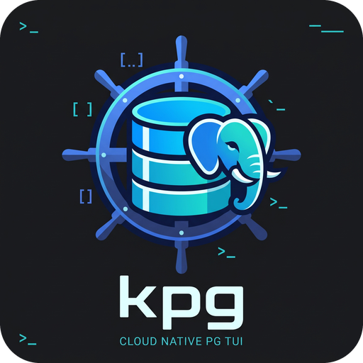

# `kpg` — CloudNativePG TUI Manager

**Interfaz interactiva de terminal (TUI) para administrar bases de datos PostgreSQL gestionadas por CloudNativePG (CNPG) en clusters Kubernetes / k3s.**


</div>

---

## ¿Qué es `kpg`?

`kpg` es una herramienta de terminal interactiva construida con **Node.js, TypeScript e Ink (React para terminal)** que envuelve `kubectl` y el plugin `kubectl-cnpg` para simplificar las tareas diarias y operativas de bases de datos PostgreSQL con **CloudNativePG** en entornos Kubernetes / k3s (especialmente clusters con almacenamiento local `local-path`).

Con `kpg` puedes crear, hibernar, escalar, trasladar de nodo sin pérdida de datos, gestionar usuarios y permisos por tabla, exponer accesos estables por NodePort, configurar TLS en caliente, generar archivos `.env` y descargar backups `.sql`, todo desde una sola interfaz en tiempo real y **sin depender de `kubectl port-forward`**.

<div align="center">
  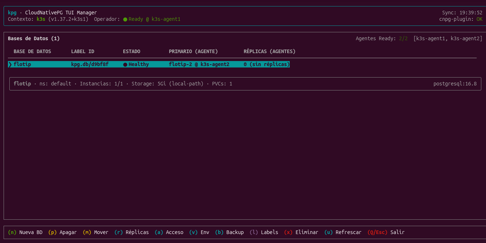
</div>

---

## Características principales

- **Verificación de entorno (*Pre-flight*) e instalador integrado:** valida `kubectl`, el plugin `kubectl-cnpg` y el operador CloudNativePG; si el operador no está instalado, permite instalarlo fijándolo al agente elegido.
- **Dashboard en tiempo real:** actualiza cada 5 segundos el estado de todas las bases de datos CNPG, sus `LABEL ID`, nodo primario y réplicas activas.
- **Creación asistida con aislamiento por agente:** crea clusters con 0 réplicas iniciales y etiqueta única aleatoria (`kpg.db/<id>=true`) para permitir múltiples bases de datos en un mismo agente.
- **Traslado automático entre agentes (0 pérdida de datos):** ejecuta un pipeline guiado de 8 etapas (etiquetado, réplica temporal, sincronización LSN con lag cero, promoción, switchover, limpieza segura de instancia/PVC antiguo y validación final) con barra de progreso.
- **Gestión de energía (Hibernación) y Réplicas:** apaga y enciende bases de datos conservando datos y configuración, o ajusta el número de réplicas protegiendo siempre el nodo primario.
- **Módulo completo de Acceso y Seguridad:** administración de usuarios y roles, permisos granulares tabla por tabla, visor de tablas/columnas, `Service` NodePort estable que sobrevive a traslados, gestión/rotación de contraseñas y política TLS en caliente (`pg_hba`).
- **Generador de archivos `.env`:** crea o previsualiza configuraciones `.env` para uno o varios usuarios con explorador de carpetas integrado.
- **Backup local directo:** descarga respaldos `.sql` vía `pg_dump` en streaming directamente a tu máquina local.
- **Binarios portables:** compilable a ejecutables independientes para **Linux x64** y **Windows x64** mediante Node.js SEA.

---

## Requisitos previos

Antes de ejecutar `kpg`, asegúrate de contar con:

1. **`kubectl`** instalado y configurado con acceso a tu cluster (`~/.kube/config`).
2. **Plugin `kubectl-cnpg`** instalado y disponible en tu `PATH` (requerido para `status`, `promote`, `destroy` y `psql`).
3. **Node.js v20+** (solo necesario si ejecutas desde código fuente; si usas los binarios compilados no lo necesitas).

---

## Instalación y ejecución

### Descargar ejecutables precompilados (Recomendado)

Puedes descargar los binarios portables (sin necesidad de instalar Node.js) directamente desde [GitHub Releases](https://github.com/k3stool/kpg/releases/latest):

* **Linux x64:** `kpg-linux` (dar permisos de ejecución con `chmod +x kpg-linux` y ejecutar `./kpg-linux`)
* **Windows x64:** `kpg-win.exe`

### Desde código fuente

```bash
# Clonar el repositorio
git clone https://github.com/k3stool/kpg.git
cd kpg

# Instalar dependencias
npm install

# Iniciar la TUI
npm start
```

### Compilar ejecutables portables (Linux / Windows)

```bash
# Compilar para Linux x64 -> dist/kpg-linux
npm run build:linux

# Compilar para Windows x64 -> dist/kpg-win.exe
npm run build:win

# Compilar para ambas plataformas
npm run build:all
```

### Variables de entorno opcionales

| Variable | Descripción |
| :--- | :--- |
| `KPG_CNPG_MANIFEST_URL` | Sobrescribe la URL del manifiesto YAML utilizado al instalar automáticamente el operador CloudNativePG desde la pantalla de arranque. |

---

## Mapa de atajos del Dashboard

Desde el menú principal puedes operar cualquier base de datos seleccionada con una sola tecla:

| Tecla | Opción | Descripción |
| :---: | :--- | :--- |
| `↑` / `↓` (o `j` / `k`) | **Navegar** | Selecciona una base de datos de la tabla en vivo. |
| `n` | **Nueva BD** | Crea un nuevo cluster PostgreSQL en el agente elegido con label único `kpg.db/<id>`. |
| `p` | **Apagar / Encender** | Hiberna (`cnpg.io/hibernation=on`) o reactiva la BD conservando PVCs, datos, labels y NodePort. |
| `m` | **Mover / Trasladar** | Traslada automáticamente una BD (con 0 réplicas) hacia otro agente disponible. |
| `r` | **Réplicas** | Escala hacia arriba o abajo el número de réplicas (`0` hasta `agentes - 1`). |
| `a` | **Acceso** | Abre el módulo de Usuarios, Permisos por tabla, Ver tablas, NodePort + Contraseñas y Política TLS. |
| `v` | **Variables `.env`** | Genera o previsualiza archivos `.env` multi-usuario con selector de carpetas. |
| `b` | **Backup** | Abre el módulo de respaldos (descarga local `.sql` vía `pg_dump`). |
| `l` | **Labels** | Muestra el panel flotante de agentes del cluster y sus etiquetas asignadas. |
| `x` | **Eliminar BD** | Elimina la BD (con confirmación por nombre exacto) limpiando NodePort, Secrets, PVCs y labels. |
| `u` | **Refrescar** | Fuerza una actualización inmediata del estado del cluster. |
| `Q` / `Esc` | **Salir / Volver** | Cierra el modal/submenú actual o sale de `kpg`. |

---

## Recorrido por las opciones

### 1. Pantalla de arranque (*Pre-flight*)

Al abrir `kpg`, la herramienta verifica automáticamente la conectividad con Kubernetes, la presencia del plugin `kubectl-cnpg` y el estado del operador CloudNativePG. Si el operador aún no existe en el cluster, `kpg` te permite instalarlo con un par de pulsaciones y fijarlo al agente que prefieras (evitando programar cargas en el `control-plane`).

<div align="center">
  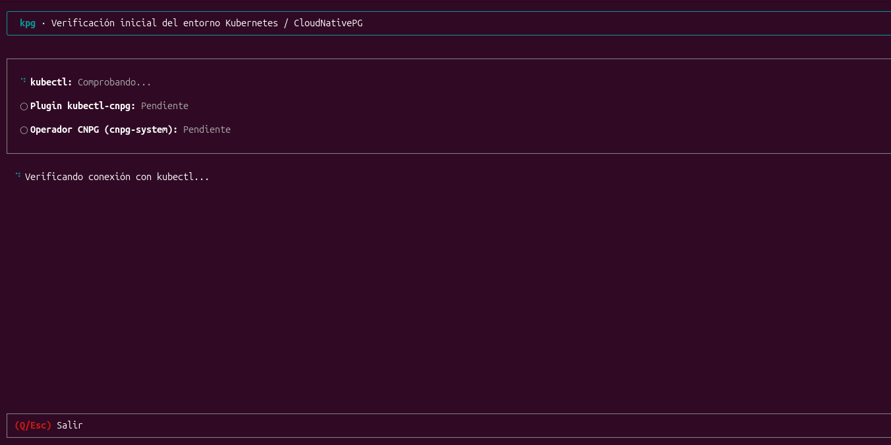
</div>

---

### 2. Crear nueva base de datos (`n`)

El asistente de creación despliega una nueva base de datos PostgreSQL con 0 réplicas iniciales (`instances: 1`), etiqueta automáticamente el agente seleccionado con una clave única `kpg.db/<id>=true` y aplica reglas de afinidad estrictas (`podAntiAffinityType: required`).

<div align="center">
  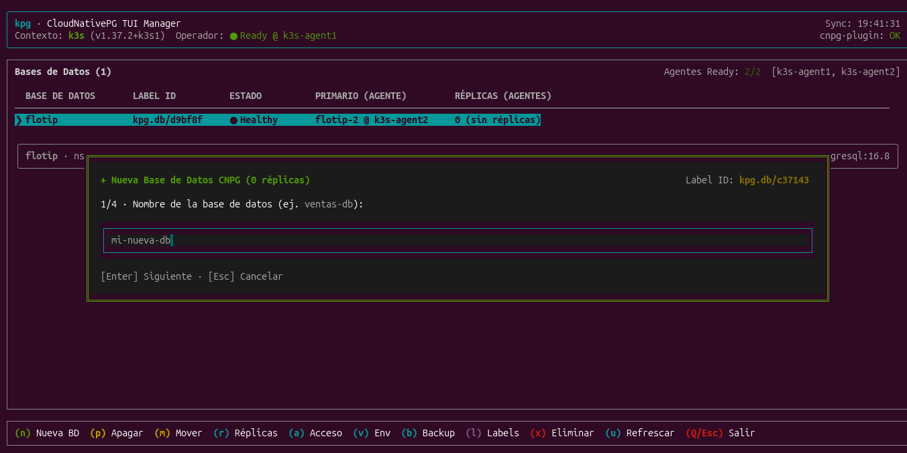
</div>

---

### 3. Traslado automático entre agentes (`m`)

Permite mover una base de datos de un nodo agente a otro de forma segura y supervisada cuando se encuentra sana y sin réplicas. El asistente ejecuta automáticamente todo el ciclo:

1. Valida el estado del cluster y los agentes disponibles.
2. Etiqueta el agente destino con el mismo `LABEL ID`.
3. Escala temporalmente a 2 instancias y espera replicación `streaming` con lag cero.
4. Promueve la nueva instancia en el agente destino y verifica el *switchover*.
5. Destruye la instancia anterior, reduce a `1` instancia, limpia el PVC antiguo y retira la etiqueta del agente origen.
6. Ejecuta una comprobación final del estado `Healthy`.

<div align="center">
  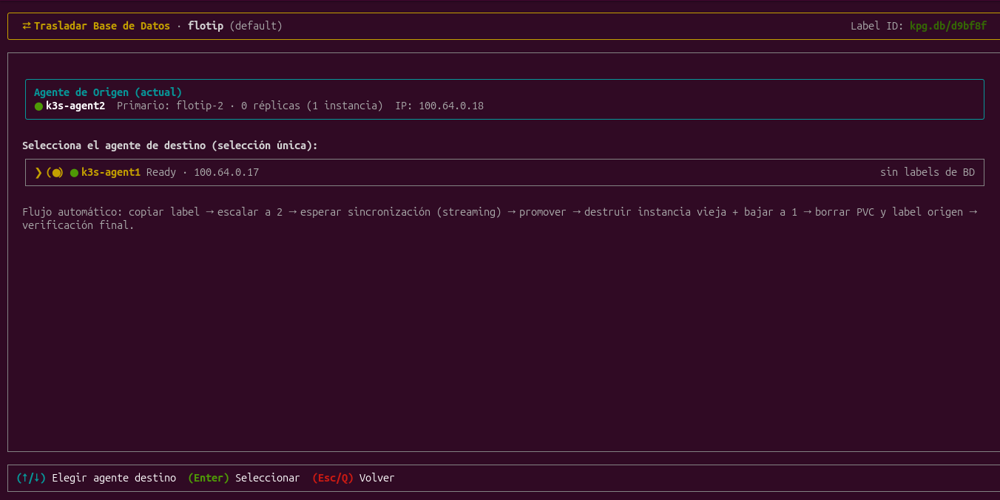
</div>

---

### 4. Réplicas (`r`) e Hibernación (`p`)

- **Réplicas (`r`):** agrega o retira réplicas seleccionando en qué agentes desplegarlas, gestionando automáticamente las etiquetas de los nodos y protegiendo siempre la instancia primaria.
- **Apagar / Encender (`p`):** hiberna una base de datos inactiva para liberar memoria y CPU sin borrar sus volúmenes persistentes (PVCs), credenciales ni su servicio NodePort.

<div align="center">
  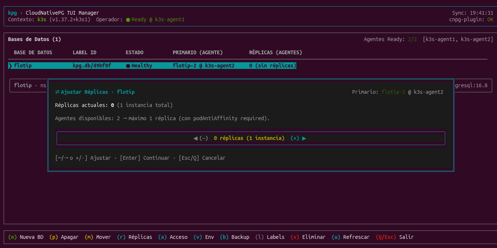
</div>

---

### 5. Módulo de Acceso y Seguridad (`a`)

Centraliza toda la administración interna y externa de PostgreSQL sin requerir túneles `port-forward`:

- **Usuarios y permisos:** lista roles, crea nuevos usuarios (con contraseña manual o autogenerada), edita permisos globales (`LOGIN`, `READ`, `WRITE`, `DDL`, `CREATEDB`, `CREATEROLE`, `SUPERUSER`), rota contraseñas y elimina roles de forma segura.
- **Permisos por tabla específica:** otorga o revoca `SELECT`, `INSERT`, `UPDATE` y `DELETE` tabla por tabla, configurando automáticamente permisos de esquema y secuencias.
- **Ver tablas:** explora las tablas de la base `app`, su propietario, filas estimadas, tamaño y estructura de columnas.

<div align="center">
  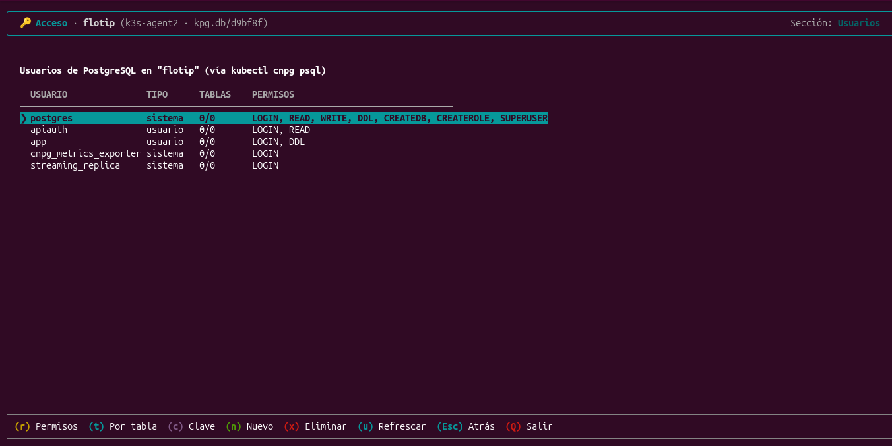
</div>

- **Acceso estable (NodePort) y contraseñas:** crea un `Service` NodePort vinculado dinámicamente al selector de primario (`-rw`) para que la conexión **sobreviva a traslados y promociones**. Muestra usuarios, contraseñas (ocultables con `p`), rotación de claves (`c`) y URL de conexión autogenerada.
- **Política TLS (clientes):** alterna en caliente vía `pg_hba` entre **Sin TLS**, **TLS Opcional** o **Solo TLS obligatorio** para clientes externos, sin reiniciar pods ni afectar la replicación interna.

<div align="center">
  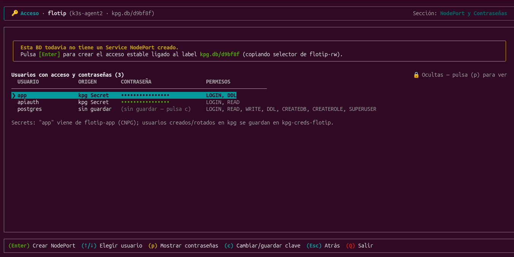
</div>

---

### 6. Generador de variables de entorno `.env` (`v`)

Genera y previsualiza archivos `.env` listos para tus aplicaciones seleccionando uno o varios usuarios de la base de datos. Incluye un explorador de carpetas integrado (o guardado rápido en el directorio actual) y adapta la cadena de conexión según la política TLS y el modo de acceso (NodePort o interno del cluster).

<div align="center">
  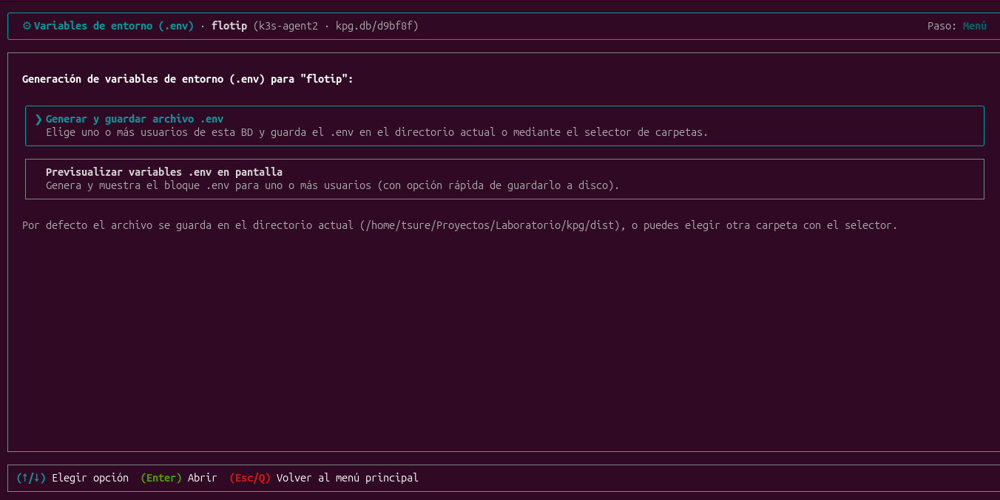
</div>

---

### 7. Backup local (`b`)

Descarga respaldos completos en formato `.sql` directamente hacia tu equipo mediante streaming con `pg_dump` sobre `kubectl exec` (sin archivos temporales en el pod ni `port-forward`), mostrando el progreso de bytes escritos y permitiendo personalizar la ruta de destino.

<div align="center">
  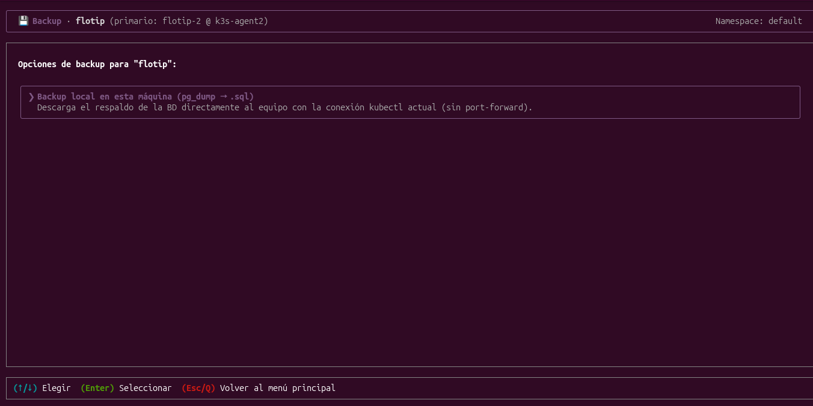
</div>

---

### 8. Inspección de Labels (`l`) y Eliminación segura (`x`)

- **Labels (`l`):** abre un panel flotante que muestra todos los agentes del cluster y sus etiquetas, resaltando el `LABEL ID` de la base de datos seleccionada (permite alternar etiquetas de sistema con `s`).
- **Eliminar BD (`x`):** solicita confirmar el nombre exacto de la base de datos antes de remover el `Service` NodePort, los `Secrets` de credenciales, el `Cluster` CNPG, PVCs residuales y las etiquetas en los agentes.

<div align="center">
  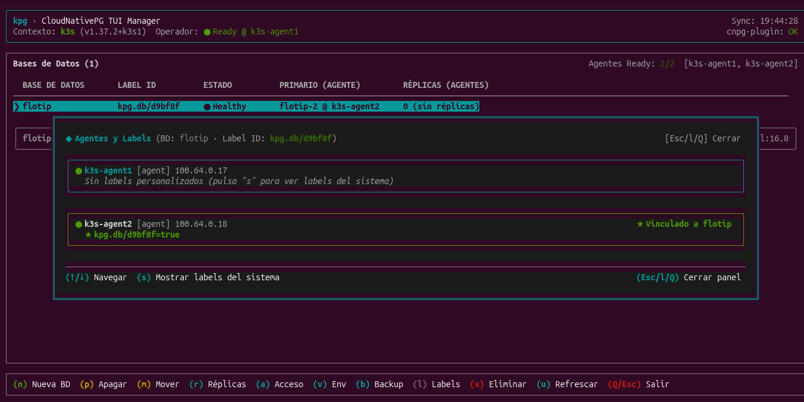
</div>

---

## Licencia

Este proyecto se distribuye bajo la licencia **ISC**.
